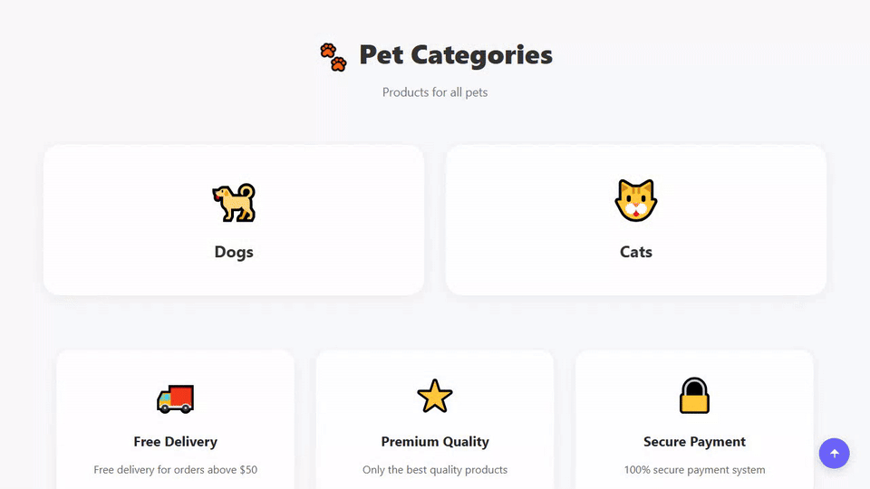
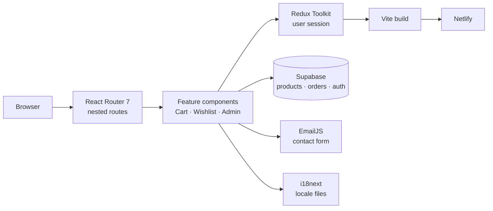
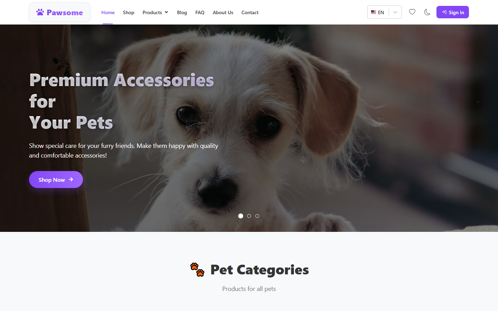
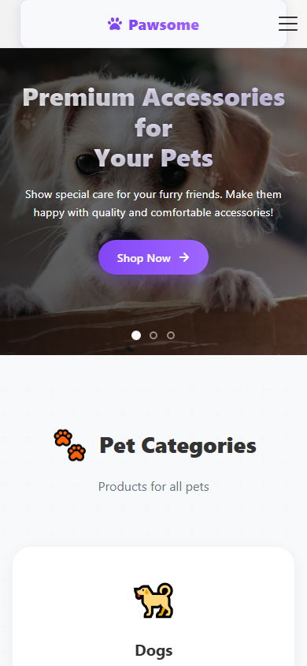

<h1 align="center">Pawsoome — Pet Shop E-Commerce</h1>

<p align="center"><b>A full pet-supply storefront — catalogue, cart, wishlist, checkout, blog and an admin dashboard — built on React with Redux Toolkit and Supabase.</b></p>

<p align="center">
<a href="https://pawsoome.netlify.app/"></a>


</p>

<p align="center"><a href="https://pawsoome.netlify.app/"><b>Live demo</b></a> &nbsp;·&nbsp; <a href="#quick-start">Quick start</a> &nbsp;·&nbsp; <a href="#features">Features</a> &nbsp;·&nbsp; <a href="#architecture">Architecture</a> &nbsp;·&nbsp; <a href="#faq">FAQ</a></p>

<p align="center">
  <a href="https://pawsoome.netlify.app/">
    
  </a>
</p>

<p align="center"><sub>Live capture of the real build — 1752 KB, loops forever.</sub></p>

## Overview

Pawsoome is the largest app I have built end to end: a multi-page e-commerce front end for a pet-supply store, covering everything from browsing a two-level category tree to placing an order and managing the catalogue from an admin panel.

The product side is split by animal (dogs / cats) and then by category — food, toys, beds, carriers, leashes, litter — so every listing route resolves through a nested router structure. Authenticated users get a persisted cart and wishlist, and an admin role unlocks a dashboard where products, orders, users and blog posts can be created, edited and deleted.

State lives in Redux Toolkit, server data and authentication in Supabase, and the whole interface is translated through i18next.

## At a glance

| Field | Detail |
| --- | --- |
| **Type** | Single-page application — Vite build |
| **Primary language** | JavaScript |
| **Live demo** | [pawsoome.netlify.app](https://pawsoome.netlify.app/) |
| **Repository** | [Mister2314/Final_Project_2](https://github.com/Mister2314/Final_Project_2) |

## Features

- Two-level catalogue: dogs & cats → food, toys, beds, carriers, leashes, litter
- Search, featured products, featured brands and featured categories on the home page
- Cart and wishlist that survive a page reload (`react-use-cart`, `react-use-wishlist`)
- Checkout flow with an order form
- Email/password authentication — register, login, forgot password
- Role-based admin panel with CRUD tables for products, orders, users and blogs
- Order statistics dashboard
- Blog with a details route, FAQ page and contact form wired to EmailJS
- Full multi-language UI via `i18next` with automatic browser language detection
- Dark / light theme through a `ThemeContext` provider
- Protected routes, scroll-to-top on navigation and toast notifications

## Tech Stack

| Layer | Technology |
| --- | --- |
| UI | React 19, React Router 7 |
| State | Redux Toolkit, React Context (theme) |
| Backend | Supabase (data + auth), EmailJS (contact form) |
| Commerce | react-use-cart, react-use-wishlist |
| i18n | i18next, react-i18next, browser language detector |
| Build | Vite, ESLint |

## Architecture



## Screenshots

| Desktop | Mobile |
| :---: | :---: |
|  |  |

## Quick Start

```bash
git clone https://github.com/Mister2314/Final_Project_2.git
cd Final_Project_2
npm install
npm run dev
```

## Project Structure

```
src/components/ — one folder per feature (Cart, Checkout, Blogs, FAQ, AdminPanel, …)
src/components/AdminPanel/ — forms, tables and order statistics for the dashboard
src/redux/ — store and slices (user session, auth bootstrap)
src/routes/AppRouter.jsx — all routes, including protected admin routes
src/language/i18n/ — translation setup and locale files
src/context/ThemeContext.jsx — dark / light theme provider
src/UseTitle/ — document title hook
```

## FAQ

<details>
<summary><b>Do I need a Supabase account to run it?</b></summary>

Yes — the app reads products, orders and users from Supabase. Create a free project and drop your URL and anon key into the env file. Everything else runs locally with `npm run dev`.

</details>

<details>
<summary><b>Is the admin panel protected?</b></summary>

It sits behind a protected route that checks the session role. A logged-in user without the admin role is redirected away from `/admin`.

</details>

<details>
<summary><b>Why Redux Toolkit and not just Context?</b></summary>

The cart, wishlist and auth session all need to be read from many unrelated components. Context would have re-rendered the whole tree on every cart change; Redux slices keep those updates scoped.

</details>

## Roadmap

- [ ] Add unit tests around the cart and order totals
- [ ] Move the data layer behind a typed API client
- [ ] Replace EmailJS with a Supabase edge function
- [ ] Add product image uploads to the admin panel

## Notes

This started as a bootcamp final project and grew into the app you see here. If I rebuilt it today I would move the data layer behind a typed API client and add tests around the cart maths — right now those are the two places where a regression would be easiest to miss.

## Author

**Xəyal Hüseynli** — Junior Front-End Developer

[Portfolio](https://hypnosdev.vercel.app) · [GitHub](https://github.com/Mister2314) · [LinkedIn](https://www.linkedin.com/in/x%C9%99yal-h%C3%BCseynli-3487b91ba/) · [xeyalhuseynli06@gmail.com](mailto:xeyalhuseynli06@gmail.com)
