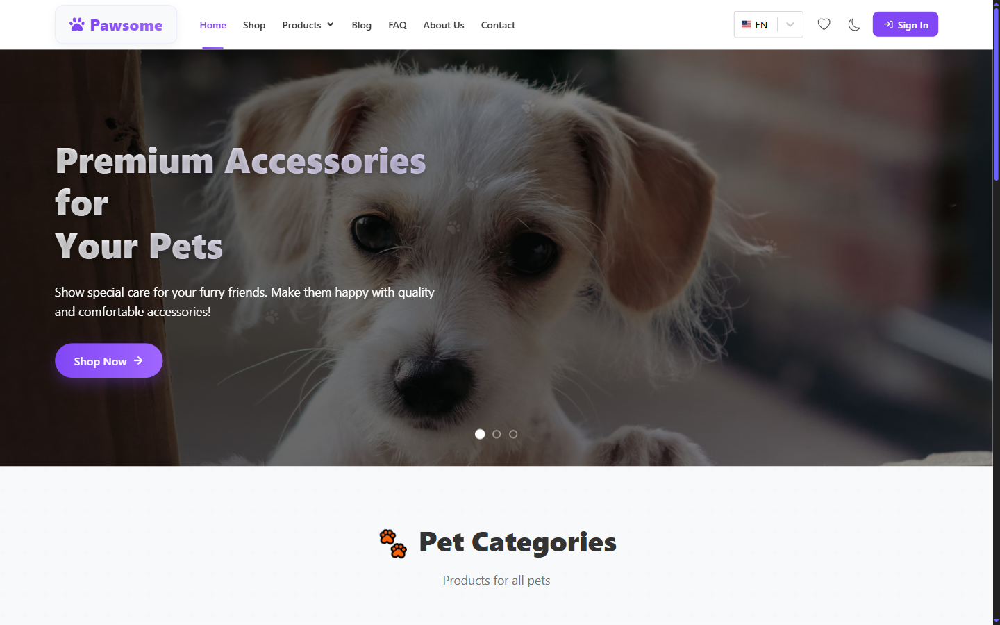
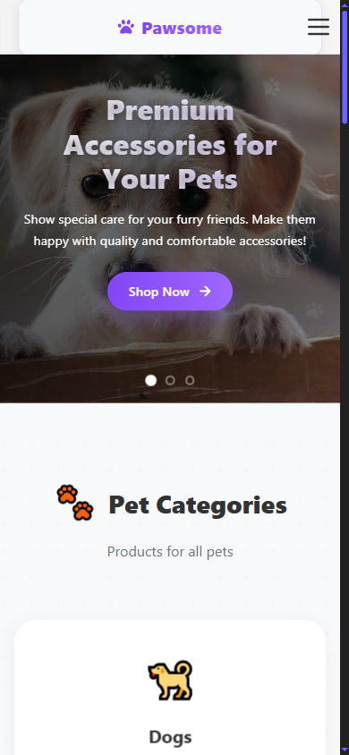

# Pawsoome — Pet Shop E-Commerce

A multi-page pet-supply storefront with catalogue, cart, wishlist, checkout, blog and a role-based admin panel, backed by Supabase.

**Live demo:** https://pawsoome.netlify.app/

<div align="center">

| Desktop | Mobile |
|---|---|
|  |  |

</div>

## What it does

The catalogue splits by animal (dogs / cats) into categories — food, toys, beds, carriers, leashes, litter — with every listing route resolving through a nested React Router structure. Authenticated users get a cart and wishlist that survive reloads; the admin role unlocks CRUD tables for products, orders, users and blog posts plus an order-statistics dashboard. State lives in Redux Toolkit, data and auth in Supabase, and the UI is fully translated through i18next with browser-language detection.

## Tech stack

React 19 · Redux Toolkit · Supabase · i18next · Vite

## Features

- Two-level catalogue via nested React Router 7 routes
- Cart and wishlist persisted across reloads (`react-use-cart`, `react-use-wishlist`)
- Email/password auth with forgot-password flow
- Admin panel behind a protected route that checks the session role
- Blog, FAQ and contact form wired to EmailJS
- Full multi-language UI via i18next, dark / light theme via `ThemeContext`

## Run locally

```bash
git clone https://github.com/Mister2314/Final_Project_2.git
cd Final_Project_2
npm install
npm run dev
```

Requires a free Supabase project — the app reads products, orders and users from it.

## What I learned

Choosing Redux Toolkit over Context for the cart and auth session kept re-renders scoped to the slices that changed instead of the whole tree.
